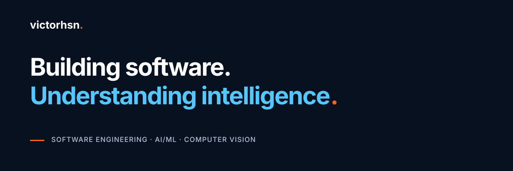

  

   <a href="https://www.linkedin.com/in/victorhsn/">LinkedIn</a>
  &nbsp;·&nbsp;
   <a href="https://www.instagram.com/victorhsn/">Instagram</a>
  &nbsp;·&nbsp;
   <a href="https://x.com/victorhsnn">Twitter/X</a>
  &nbsp;·&nbsp;
   <a href="https://www.youtube.com/@victorhsndotcom">YouTube</a>

## Hi, I'm Victor.

I'm a Senior Software Engineer with **17+ years of experience building distributed backend systems in .NET/C#**, including shipping LLM-powered agents to production.

I work across **event-driven architecture, cloud infrastructure, and agentic AI**, with a focus on the reliability engineering that keeps complex systems running: retries, idempotency, observability, and failure handling.

[Website](https://victorhsn.com) · [Articles](https://victorhsn.com)

---

## Engineering Focus

**Backend & Distributed Systems**  
.NET/C#, event-driven architecture, messaging, APIs, reliability, idempotency, and observability.

**Agentic AI & LLM Engineering**  
Python, tool calling, RAG, prompt engineering, and human-in-the-loop workflows.

**Cloud & Infrastructure**  
Microsoft Azure, infrastructure as code, deployment automation, and production operations.

**Machine Learning & Computer Vision**  
Applied AI/ML, computer vision, and the mathematical foundations of intelligent systems.

---

## Writing & Resources

I publish engineering notes, technical articles, and educational materials through **Engineering Playbook**.

### Latest Articles

[A Task That Requires More Than a Response](https://victorhsn.com/articles/a-task-that-requires-more-than-a-response)
[Using Artificial Intelligence with Intelligence](https://victorhsn.com/articles/using-artificial-intelligence-with-intelligence)

[Browse all articles](https://victorhsn.com/articles)

### Latest Resources

[Explore resources on victorhsn.com](https://victorhsn.com/resources)

---

## Connect

[Website](https://victorhsn.com) · [LinkedIn](https://www.linkedin.com/in/victorhsn/) · [YouTube](https://www.youtube.com/@victorhsndotcom)
